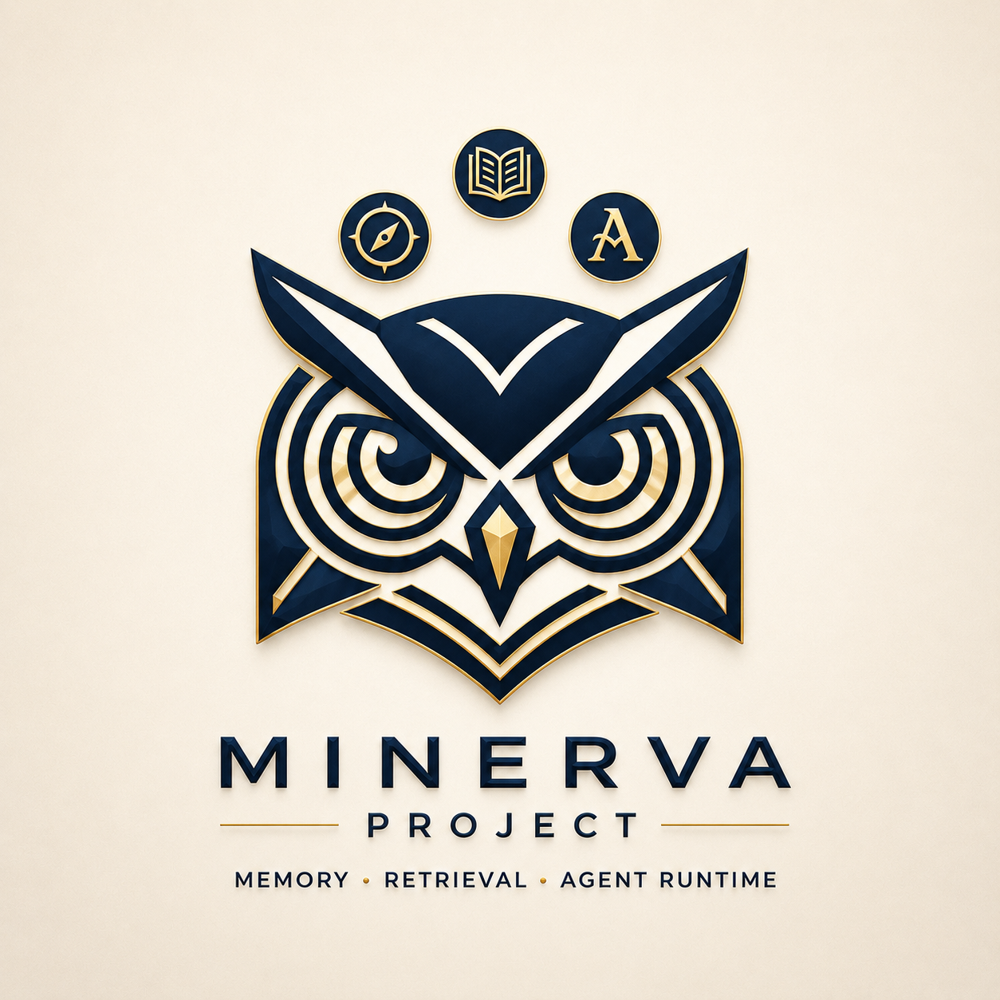
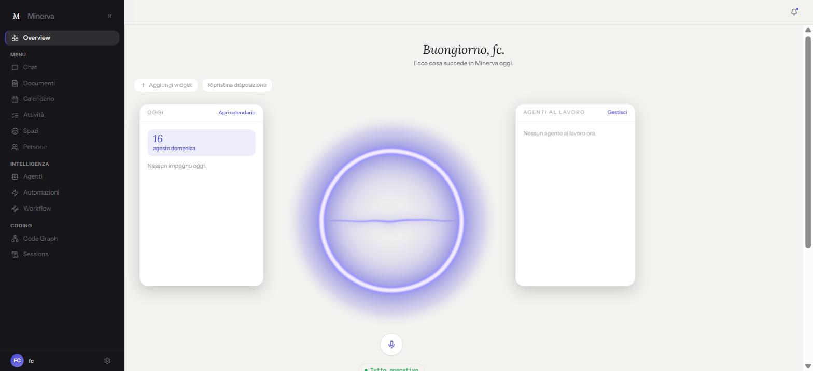
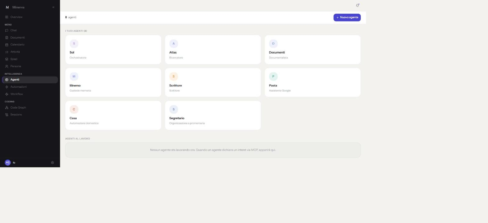
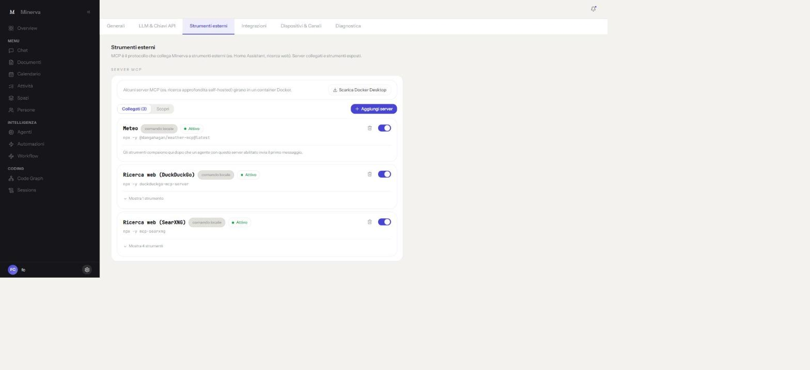
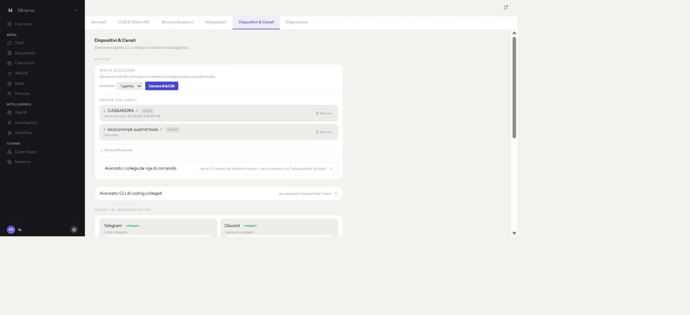

# Corax

  

  
  
  

<h3 align="center">An assistant that remembers everything. And tells no one.</h3>

  One private AI for your work, your life, and your home. 
  It runs on your own computer, and what it knows stays there.

  <a href="INSTALL.md"><b>Install Corax</b></a> ·
  <a href="#see-it">See it</a> ·
  <a href="#what-it-does-today">What works today</a> ·
  <a href="#learn-more">Docs</a>

---

## Models are replaceable. Your memory isn't.

Every AI assistant today asks you for two things: to learn how to use it,
and to hand over your life to its servers. Corax asks for neither.

**You just talk to it.** Type or speak, like you would to a person. No
prompts to learn, no workflows to build.

**It remembers.** People, plans, decisions, things left open. Tell it once,
and it brings it back when it matters, without you repeating yourself.

**It gets things done.** Calendar, email, documents, your home. It checks,
prepares, follows up, and hands longer jobs to specialized agents while you
do something else.

**What it knows stays yours.** Your memory, database, and agents live on
your machine. Not on ours. Not on anyone's.

**No lock-in.** Use a local model, or the cloud provider you prefer, and
switch whenever you want. The memory stays the same.

> The model is not your AI. Your memory, context, tools, and decisions are.
> Corax keeps them yours.

---

## Your work. Your life. Your home.

**At work**

- Reads and helps with email, documents, and the tools you already use
- Prepares briefings, does research, and follows up on open items
- Hands off longer tasks to specialized agents while you do something else

**In your life**

- Remembers people, plans, and things you've told it before
- Keeps track of your calendar and commitments

**At home**

- Connects to Home Assistant, so you can ask what's happening at home in plain language

---

## A few examples

- **"What's on today?"** Corax checks your calendar, pulls the relevant
  context from memory, and gives you a short briefing.
- **"Remember we decided to move the launch to March."** Weeks later, it
  brings that decision back when it's relevant.
- **"Research this and tell me when you're done."** An agent works in the
  background while you do something else, and reports back.
- **"Is everything off at home?"** With Home Assistant connected, it tells you.

---

## See it

**Overview** — a voice-first home screen: today's calendar, agents at work,
and a mic to just talk.

**Agents** — the specialized agents Corax can delegate to, each with its own role.

**Integrations** — the tools and services Corax connects to, with visibility
into what each one can access.

**Devices & Channels** — pair a new device with a QR code (no terminal
required), and talk to Corax from Telegram or Discord.

More in the [dashboard tour](docs/dashboard.md).

---

## Privacy, said plainly

- Your memory, database, and agent runtime stay on your machine.
- No account is needed to use Corax.
- External services (Gmail, Home Assistant, a cloud AI model) are contacted
  only when you choose to connect them.
- With a **local model**, your conversations never leave your computer.
  With a **cloud model**, the text of each request goes to the provider you
  picked; your memory still stays with you.
- Back up everything by copying one folder. No export step.

---

## For developers: one memory for all your AI tools

Personal assistants and coding tools usually keep separate memories. Corax
gives them one, under your control.

Through MCP (Model Context Protocol), the memory Corax builds is available
to Claude Code, Cursor, Codex, OpenClaw and any MCP-compatible client.
Claude Code and OpenClaw also get automatic, hands-off memory through native
lifecycle hooks. You stop explaining the same context twice.

The engine is written in Rust, runs as a single self-contained binary, and
stores memory in a local database. Setup: [INSTALL.md](INSTALL.md#connect-your-ai-and-coding-tools).

---

## What it does today

**Status: alpha, early testing.** We're looking for a small group of early
testers. If something breaks, confuses you, or should work better,
[start a discussion](https://github.com/XdotX78/Minerva-Project/discussions)
or [open an issue](https://github.com/XdotX78/Minerva-Project/issues).

Working now:

- **Dashboard** — chat, manage agents, integrations, devices and channels,
  and inspect memory, in a local browser UI
- **Chat** — text and voice, plus Telegram and Discord
- **Agents** — research, writing, home automation, scheduling, memory;
  delegated to from chat
- **Integrations** — Google (Gmail, Calendar, Drive, Tasks, YouTube), Home
  Assistant, and any MCP server you add
- **Models** — local (Ollama, LM Studio) or cloud (OpenAI, Anthropic, Groq,
  Together, Mistral, OpenRouter, Gemini)
- **MCP server** — accepting connections from supported coding clients
- **Remote access** — reachable from another machine over a private network or VPN
- **Platforms** — Linux, macOS, and Windows

On the roadmap: WhatsApp and email as messaging channels.

---

## Get Corax

**[Install guide for Windows, macOS and Linux →](INSTALL.md)**

---

## Learn more

- [Memory](docs/memory.md) — how memory works, agents, tasks, session review
- [Dashboard](docs/dashboard.md) — full tour of the local UI
- [Architecture](docs/architecture.md) — why it's fast, local-first networking
- [Claude Code integration](docs/claude-code.md) — automatic memory via lifecycle hooks
- [OpenClaw integration](docs/openclaw.md) — automatic memory via lifecycle hooks
- [Supported clients](docs/clients.md) — full connector list and setup

---

## About this repository

This is the public distribution repository: releases, install instructions,
checksums, compatibility notes, and issue tracking. It does not contain the
application source code, which remains private.

Use it for install failures, broken release assets, compatibility reports,
and documentation fixes.

## License

Corax binaries and documentation are distributed under the terms published in
the release and repository metadata. The source code remains private.
